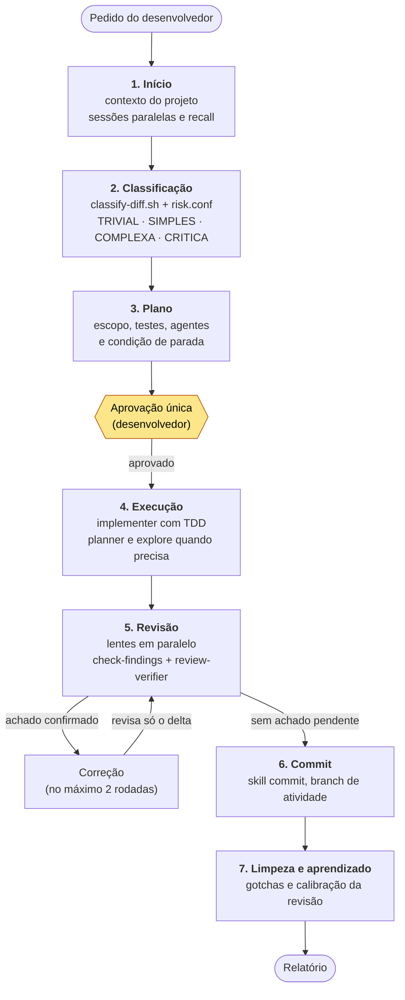

# wstack

Plugin do Claude Code com um workflow de desenvolvimento com agentes, para qualquer projeto. A sessão roda como um
coordenador técnico (o agente `lead`). Ele classifica o risco de cada tarefa, apresenta um plano, pede **uma**
aprovação e executa até a condição de parada: delega a subagentes, revisa em proporção ao risco e commita. Hooks
garantem o que não pode depender da boa vontade do modelo: travas de permissão, build e testes verdes antes de
encerrar, e push só para branch de atividade.

**Estado: versão 0.0.12.** A migração do harness para o plugin está concluída (unidades 2.2 a 2.4, ver
`docs/migracao.md`). Ficaram para depois, de propósito:
- os workflows do GitHub (gates, merge por risco, revisão de PR) e a configuração de MCP do banco, que ficam para
  depois da 0.1.0 (`docs/decisions.md`);
- a avaliação comportamental dos agentes;
- a conferência num projeto real: uma sessão com `"agent": "wstack:lead"` num projeto que passou pelo bootstrap,
  delegando aos agentes reais, e as provas `plugin/tests/prove-*.sh`, que usam o Claude Code real e rodam à mão.

## Como uma tarefa anda



Os hooks valem em todos os passos, sem depender do modelo: travas de escrita, de comando e de push na execução, e
build, formato e testes verdes antes de a sessão encerrar.

1. **Início.** Lê o contexto do projeto (`CLAUDE.md`, `.claude/project.md`, decisões), confere sessões
   paralelas no mesmo repositório (`sessions.sh`) e recupera histórico de sessões anteriores quando a área já foi
   trabalhada (skill `recall`).
2. **Classificação.** O nível de risco não é opinião do modelo. Ele vem de `scripts/classify-diff.sh`, calculado pelos
   caminhos tocados, pelo tamanho do diff e pelos globs `critical`, `complex` e `domain` do `.claude/risk.conf`. O
   `lead` pode subir o nível, nunca descer. A classificação roda no plano e de novo no diff real.
3. **Plano e aprovação única.** Escopo, exclusões, testes, agentes e uma condição de parada verificável (comando e
   resultado esperado). O desenvolvedor aprova uma vez. Dali em diante o `lead` lê, edita, testa, delega, corrige e
   commita sem pedir confirmação a cada passo. Push, PR e afrouxar testes só entram se o plano disser.
4. **Execução.** O `implementer` recebe um sprint contract delimitado e trabalha com TDD. O `planner` e o `explore`
   levantam contexto em código desconhecido.
5. **Revisão**, em quatro etapas:
   - preparar: `diff-smells.mjs` limpa código comentado e marcadores, e `review-dispatch.mjs` agrupa os arquivos e
     indica a regra de cada caminho;
   - achar: as lentes rodam em paralelo;
   - verificar: `check-findings.mjs` descarta o achado cujo trecho não existe no código, e o `review-verifier` tenta
     refutar cada candidato;
   - corrigir: só o confirmado é corrigido, e o delta é revisto de novo (no máximo duas rodadas).
6. **Commit** pela skill `commit` (Conventional Commits, em português), numa branch de atividade.
7. **Limpeza e aprendizado.** Remove o que a sessão criou (worktrees, branches temporárias, contêineres) e registra o
   que aprendeu em `docs/gotchas/` e em `docs/review-calibration.md`, que calibra a revisão ao longo do tempo.

### Níveis de risco

| Nível | Quando | Revisão |
|---|---|---|
| TRIVIAL | até 3 arquivos e 50 linhas, um domínio, nada crítico | `review-agent` e `review-verifier`; doc pura só com checagens determinísticas |
| SIMPLES | até 5 arquivos e 200 linhas, um domínio | caminho rápido na sessão; caminho pesado em segundo plano |
| COMPLEXA | acima disso, vários domínios ou glob `complex` | plano completo; caminho pesado em segundo plano, com `security-agent` se houver superfície |
| CRITICA | glob `critical` (auth, segredos, migrations, contratos públicos...) ou teste removido | tudo da COMPLEXA mais `review-critical`; o caminho pesado roda antes do commit, com prova do fato de segurança |

O **caminho rápido** é a camada determinística (build, formato, testes, garantidos pelo hook `Stop`) mais o
`review-agent` e o `review-verifier`. O **caminho pesado** soma benchmark nas áreas quentes, sinais de qualidade,
`review-simplicity`, as lentes condicionais e os especialistas. Sem `risk.conf`, o classificador devolve CRITICA.

## O que tem no plugin

```text
.claude-plugin/marketplace.json   marketplace "wstack" (um plugin, em ./plugin)
plugin/
  .claude-plugin/plugin.json      nome e versão
  agents/       18 subagentes (wstack:<nome>)
  skills/       25 skills (/wstack:<nome>)
  hooks/        hooks.json e as travas e verificações
  scripts/      scripts que as skills, os agentes e os hooks chamam
  cloud/        setup.sh do ambiente da nuvem
  templates/    modelos que o /wstack:bootstrap copia para o projeto
  tests/        testes (CI) e provas com o Claude Code real (à mão)
docs/           decisões, inventário da migração, matriz de garantias, sondas
```

### Agentes

| Agente | Modelo | Papel |
|---|---|---|
| `lead` | o da sessão (Opus) | coordenador: classifica, planeja, delega, revisa, commita |
| `planner` | Opus | contexto amplo e plano preliminar, somente leitura |
| `explore` | Haiku | localizar código e mapear impacto, somente leitura |
| `implementer` | Sonnet | implementa um sprint contract com TDD |
| `simplify` | Sonnet | aplica achados de simplicidade confirmados |
| `review-agent` | Sonnet | lente de corretude (toda alteração de código) |
| `review-simplicity` | Sonnet | lente de simplicidade e reuso |
| `review-failures` | Sonnet | lente de tratamento de erro (condicional) |
| `review-domain` | Sonnet | lente de modelagem de domínio (condicional) |
| `review-verifier` | Opus | tenta refutar cada candidato antes de qualquer correção |
| `review-critical` | Opus | revisão independente do nível CRITICA |
| `security-agent` | Opus | auditoria adversarial de segurança |
| `database-helper` | Haiku | consulta o banco real via MCP, somente leitura |
| `database-reviewer` | Opus | migrations, queries, índices, locks, rollback |
| `performance-agent` | Opus | investiga gargalo com medição |
| `playwright-e2e` | Sonnet | testes E2E com Playwright |
| `e2e-critical-review` | Opus | E2E crítico e flakiness |
| `ci-reviewer` | Sonnet | revisão de PR dentro do GitHub Actions |

### Skills

- **Workflow:** `lead` (o processo acima), `commit`, `review-rubric` (régua comum de severidade, evidência e formato
  dos achados), `test-audit` (gate de autoria de testes e auditoria), `recall` (sessões anteriores), `bootstrap`
  (adoção num projeto).
- **Engenharia:** `tdd`, `testing-strategy`, `clean-code`, `refactoring`, `clean-architecture`, `vertical-slice`,
  `domain-modeling`, `api-design`, `concurrency`, `resilience`, `event-driven`, `observability`, `security`,
  `performance`, `continuous-delivery`, `frontend`, `ux`.
- **Banco:** `db-evolution` (migrations e schema), `query-plan` (plano de execução no banco real).

As referências por stack ficam em `reference/*.md`: .NET, Node, Bash e frontend web em `performance` e
`review-rubric` (esta também tem regras por caminho), e EF Core e PostgreSQL em `query-plan`.

### Hooks

| Evento | Hook | O que faz |
|---|---|---|
| `PreToolUse` Edit/Write | `write-guard` | a ferramenta de escrita não grava em `.git`, na config do git nem na pasta do plugin |
| `PreToolUse` Bash | `push-guard` | push só na forma exata, para branch de atividade, nunca na padrão; pede aprovação se publica caminho protegido |
| | `path-guard` | pede aprovação para comando que cita trava (`settings.json`, `risk.conf`, `.git`, workflows, a pasta do plugin) ou segredo |
| | `redirect-guard` | pede aprovação para `>` fora das formas fechadas |
| | `git-read-allow` | aprova `git log/diff/show` na forma fechada |
| | `script-allow` | aprova os scripts do plugin na forma fechada |
| | `checkpoint-tests` | roda os testes da área antes do `git commit` |
| `TaskCompleted` | `checkpoint-tests` | idem, ao fechar uma tarefa |
| `PostToolUse` edição | `edit-check` | lint e formatação do arquivo recém-editado |
| | `iteration-guard` | lembra a regra das três tentativas a cada N edições sem commit |
| `Stop` | `verify-on-stop` | não encerra com build, formato ou teste vermelho, nem sem registro de aprendizado depois de commit de código |
| `SessionStart` | `session-start`, `sessions.sh`, `map-staleness`, `cloud-services` | versão em uso, registro da sessão, aviso de mapa de features velho, serviços da nuvem |
| `SessionEnd` | `sessions.sh` | tira a sessão do registro |
| `Notification` | `notify` | aviso do sistema operacional quando a sessão espera você |

Os hooks são cinto de segurança, não fronteira: leem o texto do comando, e um caminho montado para esconder não
aparece. A fronteira é o PR, o isolamento e o `deny` do `settings.json`. O que cada mecanismo garante, o que não
garante e o teste que prova estão em `docs/harness-capabilities.md`.

### Scripts

Os principais: `classify-diff.sh` (nível de risco), `review-dispatch.mjs`, `diff-smells.mjs` e `check-findings.mjs`
(revisão), `quality-signals.sh` e `bench-compare.sh` (sinais de qualidade e benchmark), `sessions.sh`,
`nova-atividade.sh` e `worktree-env.sh` (sessões em paralelo, cada uma numa worktree), `checkpoint.sh` (checkpoint da
sessão na nuvem), `prune-merged.sh` (limpa branches de PR mesclado), `bootstrap.sh` (modelos do projeto). A lista
completa, com quem chama cada um, está em `docs/migracao.md`.

## Adotar num projeto

1. Ter o plugin na sessão. **Na nuvem:** colar `plugin/cloud/setup.sh` no setup script do ambiente; já na primeira
   sessão o plugin está instalado (ver Primeira vez na nuvem). **No Claude Code local:**
   `/plugin marketplace add wesllenm/wstack` e `/plugin install wstack@wstack`.
2. Rodar `/wstack:bootstrap`. Ele diagnostica o repositório (stacks, comandos de build e teste, branch padrão),
   propõe os arquivos e, com a aprovação, cria o que faltar, sem sobrescrever nada que já exista:

   | Arquivo | Para quê |
   |---|---|
   | `.claude/settings.json` | agente `wstack:lead`, plugin fixado em `v<versão>`, permissões (`deny`, `ask`, `allow`) |
   | `.claude/risk.conf` | globs de risco, comandos de verificação (`verify_*`), prefixos de branch, caminhos protegidos |
   | `CLAUDE.md` | regras do projeto, comandos e o que o código não mostra |
   | `.claude/project.md`, `.claude/architecture.md` | produto, domínios (com a skill de cada um) e arquitetura |
   | `.claude/cloud/hosts.conf` | hosts que a nuvem precisa por stack |
   | `docs/review-rubric.md` | complemento da rubrica: Sempre verificar, Não reportar, Projeto |
   | `docs/review-calibration.md`, `docs/gotchas.md`, `docs/decisions.md` | aprendizado e decisões do projeto |
   | `.claude/skills/verify-<app>/` | esqueleto da skill que sobe a aplicação e prova comportamento (só com aplicação) |

3. Revisar e preencher o que o bootstrap deixa ao projeto: os `<...>` dos modelos (a skill preenche o que consegue
   detectar) e a receita da `verify-<app>`, que sai como esqueleto. Commitar na branch `chore/bootstrap-wstack` e
   fazer o merge.
### Primeira vez na nuvem

Na nuvem, o `.claude/settings.json` do projeto não instala o plugin sozinho (`docs/sonda.md`, fato 1): quem instala é o
setup script, a cada contêiner novo. O projeto nasce na nuvem assim:

1. Criar o ambiente em claude.ai/code com o repositório do projeto (pode estar vazio) e colar `plugin/cloud/setup.sh`
   no setup script. A rede do ambiente precisa alcançar `github.com`, de onde o plugin é clonado.
2. Abrir a sessão. Como o projeto ainda não cita o plugin, o setup instala a maior tag `v<versão>` publicada do wstack,
   e a sessão começa com "Projeto sem o wstack: ... /wstack:bootstrap".
3. Rodar `/wstack:bootstrap`, aprovar a proposta e fazer o merge da `chore/bootstrap-wstack`. O `settings.json` gerado
   fixa a mesma tag.
4. Da sessão seguinte em diante, o setup instala a versão que o projeto fixou, e o `--check` de cada sessão aponta o
   que falta (ferramentas da stack, plugin em outra versão).

### Cobertura por stack

O workflow, as travas, a classificação de risco e a revisão não dependem de linguagem: valem para qualquer
repositório git. O que depende da stack:
- **Ferramentas na nuvem:** o `setup.sh` instala .NET (SDK do `global.json`), Node (dependências de cada pasta com
  lockfile), Rust, Go e Python (`.venv` com os `requirements*.txt`). Outra stack (Java, por exemplo) entra no setup
  script do ambiente à mão.
- **Referências específicas** de revisão e performance: .NET, Node, Bash e frontend web; de plano de execução: EF Core
  e PostgreSQL. Nas outras stacks, as skills de engenharia valem do mesmo jeito, com orientação genérica.
- **Comandos de build, formato e teste:** são do projeto, declarados nas chaves `verify_*` do `.claude/risk.conf`; o
  hook `Stop` roda os que estiverem ali.

O projeto mantém os próprios arquivos. Uma mudança em skill, agente ou hook do plugin vira proposta aqui no wstack,
não edição no projeto.

**Repositório sem bootstrap.** Com o plugin instalado no escopo do usuário, ele roda em todo repositório. Sem
`.claude/risk.conf` (fora da árvore e de todo commit apontado), os hooks de workflow ficam inertes e só as travas de
segurança continuam (`docs/decisions.md`, plugin inerte sem risk.conf).

## Versões

Cada projeto fixa a versão pela tag no `ref` do marketplace, no seu `.claude/settings.json`. Para publicar uma
versão:
1. Subir `version` em `plugin/.claude-plugin/plugin.json` no PR.
2. Depois do merge, criar a tag na `main` e enviá-la, de uma máquina com permissão de push:

   ```bash
   git tag -a v<versão> -m "wstack <versão>" <commit do merge>
   git push origin v<versão>
   ```

Para atualizar um projeto, troque o `ref` no `.claude/settings.json` dele. O setup da nuvem reinstala na próxima
sessão.

## Desenvolver o plugin

- Testes: `for t in plugin/tests/test-*.sh; do bash "$t" || exit 1; done` (precisa de bash, git, jq e node). O CI
  (`.github/workflows/ci.yml`) roda os mesmos testes em todo PR.
- Validação: `claude plugin validate plugin` e `claude plugin validate .`.
- Documentos:
  - `docs/decisions.md`: as decisões e o porquê;
  - `docs/harness-capabilities.md`: as garantias de cada mecanismo e os riscos aceitos;
  - `docs/migracao.md`: de onde veio cada arquivo e o estado de cada unidade;
  - `docs/sonda.md`: fatos do Claude Code medidos nas sondas.
